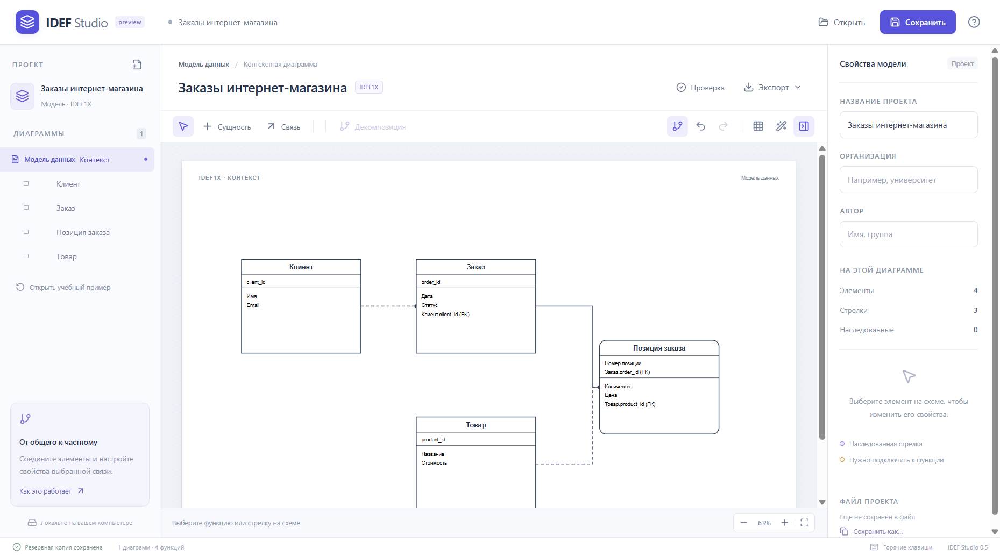

# IDEF Studio

Локальный учебный редактор диаграмм для Windows. Версия 0.5.0, предварительный выпуск.

| Нотация | Доступно | Ограничения |
| --- | --- | --- |
| IDEF0 | Контекст, декомпозиция, наследование стрелок, ICOM, туннели | Нет полной проверки стандарта |
| DFD | Процессы, сущности, хранилища, перенос потоков при декомпозиции | Базовая структурная проверка |
| IDEF3 | Действия, предшествование, AND/OR/XOR, декомпозиция | Нет синхронных перекрёстков, референтов и состояний объектов |
| IDEF1X | Атрибуты, PK/FK, типы связей, кардинальность | Нет подтипов, альтернативных ключей, SQL и полной проверки циклов |



## Запуск

Скачайте ZIP приложения из Releases, распакуйте полностью и запустите IDEF Studio.exe. Node.js для готовой программы не нужен. Проверено на Windows 11 x64; Windows 10 отдельно не проверена. Сборка не подписана сертификатом издателя.

Для примера нажмите «Открыть учебный пример» и выберите нотацию. Доступны мебельная мастерская, обработка заказов, ремонт устройства и модель данных интернет-магазина.

Сохраняйте проекты в .idef.json. Экспорт SVG/PDF сохраняет текущую диаграмму. Ctrl+S/O/Z/Y работают в английской и русской раскладке. Мостики обозначают пересечение линий без соединения. Совпадающие участки разводятся опорными точками.

В IDEF1X задавайте атрибуты по строке, PK перед ключом. Соединяйте родителя с дочерней сущностью: FK вычисляются автоматически. Не создавайте циклические идентифицирующие связи.

## Разработка

Требуется Node.js 24 и Windows для запуска Electron и сборки приложения.

```sh
npm ci
npm test
npm run build
npm start
npm run package
```

Проверки интерфейса: node tests/examples-ui.cjs и node tests/idef1x-ui.cjs. GitHub Actions проверяет код и создаёт артефакт Windows. Первый запуск workflow на GitHub нужно проверить после загрузки репозитория.

## Хранение и совместимость

Формат файла — 3; читаются форматы 1/2. Старые приложения могут не понимать новые нотации. При открытии старого формата предлагается отдельное имя файла.

Постоянный appId: local.idefstudio.app. Для совместимости с установленной версией 0.5 профиль закреплён в %APPDATA%/IDEF Studio 0.5. Имя этой папки больше не меняется при выпуске версий. Из 0.1–0.4 переносите проекты через сохранение и открытие файла. Несохранённые данные старых профилей не удаляются.

## Лицензия

GPL-3.0-only, см. LICENSE. Уведомления зависимостей — THIRD_PARTY_NOTICES.txt. При распространении сборок сохраняйте лицензии Electron/Chromium из папки сборки и предоставляйте соответствующие исходники с инструкцией сборки.

См. CONTRIBUTING.md, SECURITY.md и RELEASE.md.
